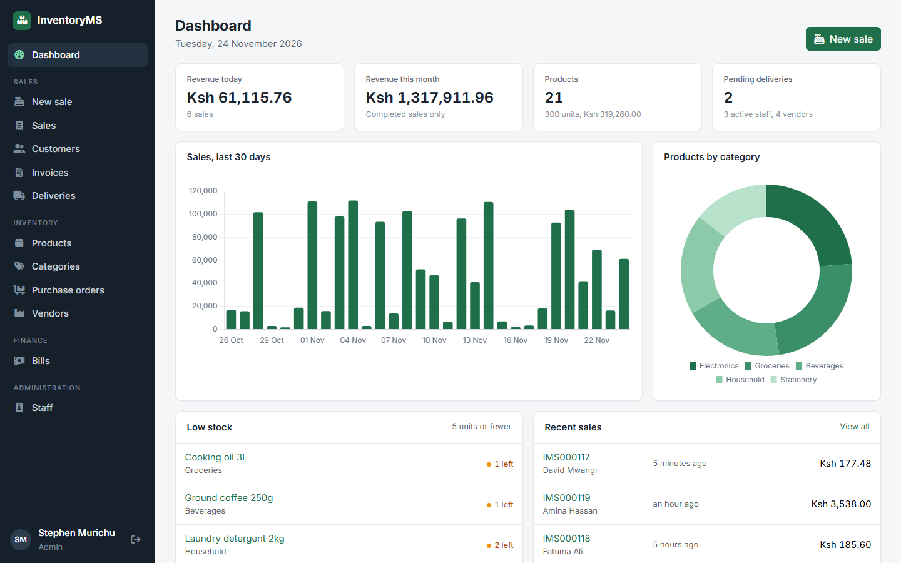
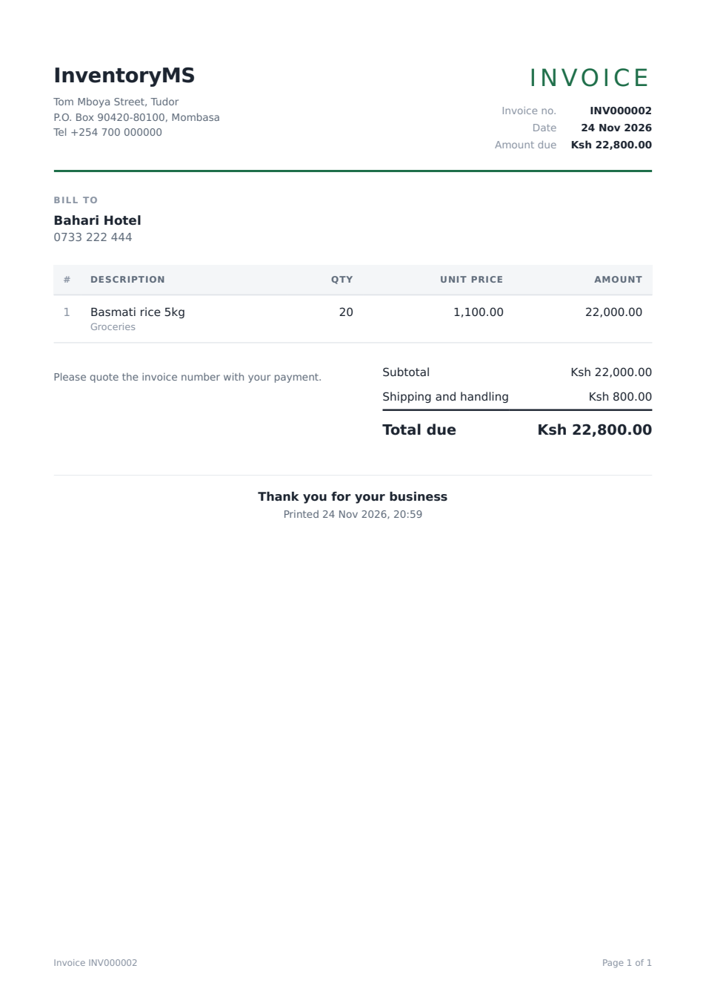
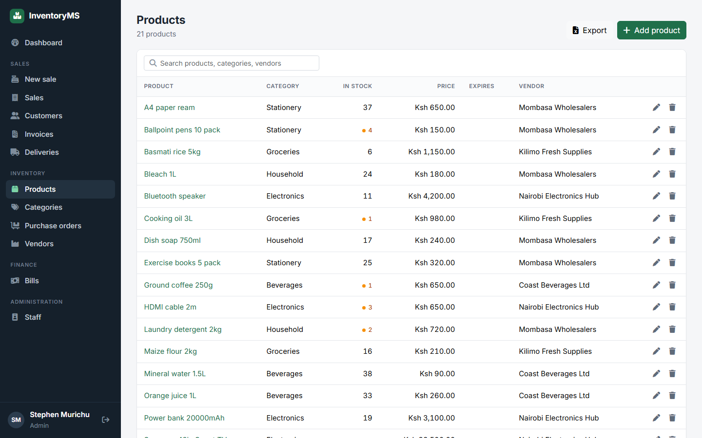
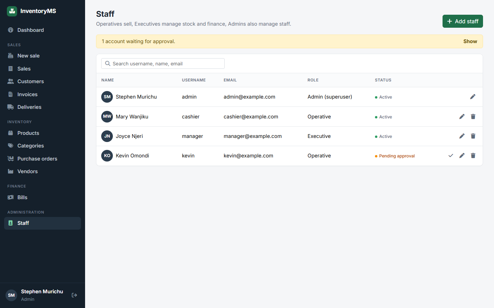
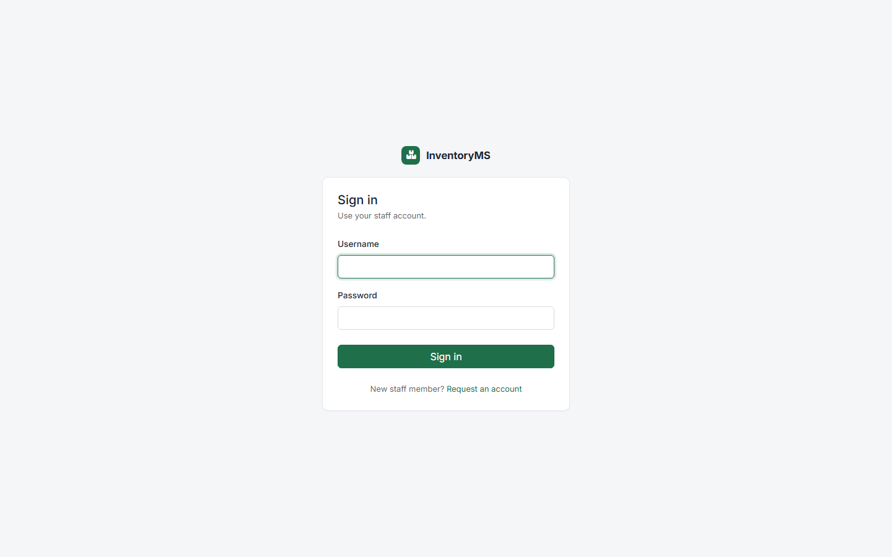

<div align="center">
  
</div>

# Django-inventory-management
[](https://opensource.org/license/mit)
[](https://www.python.org/downloads/)
[](https://www.djangoproject.com/)

Point of sale, stock control, purchasing, invoicing and loyalty points for a retail shop, built with Django.

## Table of Contents
- [Features](#features)
- [Roles](#roles)
- [Screenshots](#screenshots)
- [Installation](#installation)
  - [With Docker](#with-docker)
  - [Without Docker](#without-docker)
- [Configuration](#configuration)
- [Upgrading an existing database](#upgrading-an-existing-database)
- [Running the tests](#running-the-tests)
- [Authors](#authors)

## Features

- **Point of sale.** Search items and customers, see stock while you sell, redeem loyalty points, and get the change worked out. The server prices every sale from the database inside a locked transaction, so totals can't be tampered with and two tills can't oversell the same stock.
- **Receipts and invoices as PDF.** Professional A4 documents rendered with [WeasyPrint](https://weasyprint.org/). **Print** opens the PDF in the browser's viewer; **Download** saves it. A voided sale's receipt carries a VOID watermark.
- **Stock that stays correct.** Purchase orders add stock only when they are received. Editing or deleting an order adjusts stock by the difference. Stock can never go negative.
- **Voids, not deletes.** Voiding a sale returns the items to stock and reverses loyalty points. The sale stays on record.
- **Loyalty points.** Customers earn points on every sale (1 point per Ksh 100 by default) and redeem them as a discount before tax. Every change is logged in a ledger; managers can make recorded corrections.
- **Dashboard.** Revenue today and this month, stock value, low stock alerts, a 30-day sales chart and recent sales.
- **Accounts and security.** Role based access, staff approval for self sign-ups, login throttling, immediate sign-out of deactivated staff, and secure production settings.
- **Exports.** Sales, purchases, products and deliveries to Excel (managers only).

## Roles

| Role | Can do |
| --- | --- |
| **Operative** | Sell, print receipts, view stock and invoices, manage customers and deliveries |
| **Executive** | Everything above, plus products, categories, purchase orders, vendors, invoices, bills, exports, voiding sales and point adjustments |
| **Admin** | Everything, plus staff accounts, roles and approvals |

New sign-ups wait for an Admin to approve them on the **Staff** page. Django superusers are always Admin.

## Screenshots

| Dashboard | Point of sale |
| --- | --- |
|  |  |

| Receipt (PDF) | Invoice (PDF) |
| --- | --- |
|  |  |

<details>
  <summary>More screenshots</summary>

  **Sale detail.** A summary for staff, with Print, Download and Void actions.
  

  **Sales**
  

  **Products,** with low stock and out-of-stock flags
  

  **Customer loyalty history**
  

  **Purchase orders**
  

  **Staff and approvals**
  

  **Sign in**
  

  **Mobile**

  
</details>

## Installation

```bash
git clone https://github.com/munuhee/sales-and-inventory-management.git
cd sales-and-inventory-management
cp .env.example .env    # then edit it
```

### With Docker

The image includes the system libraries WeasyPrint needs.

```bash
docker build -t sales-and-inventory-management .
docker run -d -p 8000:8000 \
  -e SECRET_KEY="change-me" \
  -e ALLOWED_HOSTS="localhost,127.0.0.1" \
  sales-and-inventory-management
```

The container runs migrations, then serves the app with Gunicorn. Add `-e DEBUG=True` for a local trial.

### Without Docker

1. Create a virtual environment and install the dependencies:

    ```bash
    python3 -m venv venv
    source venv/bin/activate          # Windows: venv\Scripts\activate
    pip install -r requirements.txt
    ```

2. Install the system libraries WeasyPrint needs to render PDFs:
    - **Debian/Ubuntu:** `sudo apt install libpango-1.0-0 libpangoft2-1.0-0 libharfbuzz-subset0`
    - **macOS:** `brew install pango`
    - **Windows:** install the GTK3 runtime, see the [WeasyPrint guide](https://doc.courtbouillon.org/weasyprint/stable/first_steps.html#windows).

    Everything except PDF generation works without them.

3. Set up the database and run the server:

    ```bash
    python manage.py migrate
    python manage.py seed_demo        # optional demo data, empty database only
    python manage.py createsuperuser  # or use the demo accounts
    python manage.py runserver
    ```

`seed_demo` creates the sign-ins `admin`, `manager` and `cashier`, all with the password `demo-pass-123`. It refuses to run when `DEBUG` is off.

## Configuration

All settings come from environment variables (or a `.env` file). See [.env.example](.env.example) for the full list.

| Variable | Purpose |
| --- | --- |
| `DEBUG` | `True` for development. Defaults to `False`. |
| `SECRET_KEY` | Required when `DEBUG` is off. |
| `ALLOWED_HOSTS`, `CSRF_TRUSTED_ORIGINS` | Comma separated. On Azure App Service the site host is added automatically. |
| `DB_HOST`, `DB_NAME`, `DB_USER`, `DB_PASSWORD` | PostgreSQL. SQLite is used when `DB_HOST` is empty. The `AZURE_POSTGRESQL_*` names also work. |
| `ALLOW_REGISTRATION` | Show the "Request an account" page. Defaults to `True`. |
| `BUSINESS_NAME`, `BUSINESS_ADDRESS`, `BUSINESS_PHONE`, `BUSINESS_TAX_PIN`, `BUSINESS_CURRENCY` | Printed on receipts and invoices. |
| `LOYALTY_EARN_PER`, `LOYALTY_POINT_VALUE`, `LOYALTY_MIN_REDEEM`, `LOYALTY_ENABLED` | Loyalty programme rules. |

## Upgrading an existing database

Run `python manage.py migrate`. The migrations:

- convert money fields from floats to exact decimals, and phone numbers to text;
- mark existing staff accounts **Active** so nobody is locked out (only new sign-ups need approval), and make superusers Admin;
- clamp any negative stock or loyalty balance to zero;
- record each customer's existing points as an opening balance in the loyalty ledger;
- repair invoice and bill links that had empty slugs.

## Running the tests

```bash
python manage.py test
```

PDF tests are skipped if WeasyPrint's system libraries are missing. They run in CI and in the Docker image:

```bash
docker run --rm -e DEBUG=True sales-and-inventory-management python manage.py test
```

## Authors

- [Stephen Murichu](https://github.com/munuhee)

                                            Happy coding! 🚀
